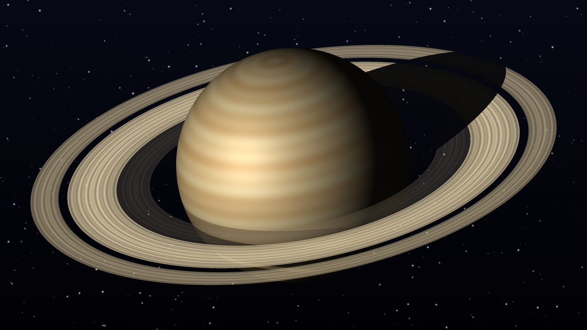

# 🪐 Saturne, pixel par pixel

> Une image de Saturne et de ses anneaux, entièrement calculée en C++ : géométrie, éclairage, ombres et fichier BMP, sans aucune bibliothèque graphique.




*Image produite par le programme, convertie en PNG pour l'affichage sur GitHub.*

## ✨ Ce que calcule le programme

- **Des anneaux aux proportions réelles** : les anneaux C, B et A, séparés par la division de Cassini, avec les dimensions mesurées sur le vrai Saturne.
- **Une planète en volume**, traitée comme une sphère : bandes nuageuses, éclairage diffus (loi de Lambert), reflet (modèle de Blinn-Phong) et bord assombri.
- **De vraies ombres**, obtenues en suivant les rayons du Soleil : l'ombre de la planète sur les anneaux et celle des anneaux sur la planète.
- **Le bon ordre d'affichage** : les anneaux passent devant la planète en bas et derrière en haut, et l'anneau C, peu dense, laisse voir ce qui se trouve derrière lui.
- **Des bords lisses** grâce au sur-échantillonnage : 9 calculs par pixel, soit 8,3 millions pour l'image complète.
- **Un ciel étoilé généré** par le programme : aucune photo n'est utilisée.
- **Un fichier BMP écrit octet par octet**, sans bibliothèque d'images.
- **41 vérifications automatiques** lancées avec `ctest`.

## 🚀 Compiler et lancer

Il faut un compilateur C++20 (GCC/MinGW, Clang ou MSVC) et CMake 3.20 ou plus récent.

```bash
git clone https://github.com/NassimSeguer/saturne-cpp.git
cd saturne-cpp
cmake -S . -B build
cmake --build build
./build/saturne
```

Sous Windows, lancez `build\saturne.exe`. Le programme crée le fichier `saturne.bmp`, que n'importe quelle visionneuse d'images peut ouvrir.

On peut aussi choisir le nom du fichier et la taille de l'image, entre 100 et 8000 pixels de côté :

```bash
./build/saturne grande.bmp 1920 1080
```

### Lancer les tests

```bash
ctest --test-dir build --output-on-failure
```

## 🗂️ Organisation du code

```
saturne-cpp/
├── CMakeLists.txt
├── images/           aperçu affiché dans ce README
├── include/          les en-têtes : chaque fonction y est documentée
├── src/              le code des modules
└── tests/
    └── tests.cpp     tests automatiques
```

| Module | Rôle |
|---|---|
| `couleur` | Représentation, mélange et conversion des couleurs |
| `vecteur` | Calculs sur les vecteurs de l'espace : produit scalaire, norme, rotation |
| `image` | Tableau de pixels et écriture du format BMP |
| `etoiles` | Fond de ciel étoilé |
| `scene` | Géométrie, éclairage et ombres de Saturne |
| `rendu` | Calcul de l'image complète, avec anticrénelage |

Chaque fonction est documentée dans son en-tête : rôle, but, paramètres et valeur de retour.

## 🧠 Points techniques

### Du pixel au point de l'espace

On regarde la scène de face : un pixel (u, v) peut correspondre à n'importe quel point (u, v, z). Pour savoir ce qu'il montre, on calcule la coordonnée z de chaque objet.

- **Sur les anneaux** : le plan des anneaux passe par le centre de la planète, donc ses points vérifient `n · P = 0`, où `n` est perpendiculaire au plan. On en déduit z. La distance du point au centre indique ensuite quel anneau est touché.
- **Sur la planète** : un point de la face visible vérifie `u² + v² + z² = r²`.

```
anneaux :  z = −(nₓ·u + n_y·v) / n_z
planète :  z = √(r² − u² − v²)
```

Le signe de z sur les anneaux donne l'ordre d'affichage : si z > 0, ce morceau d'anneau est plus proche de nous que le centre de la planète et passe devant elle. Sinon, il est caché.

### Les dimensions des anneaux

| Élément | Distance au centre (en rayons de Saturne) | Aspect |
|---|---|---|
| Anneau C | 1,239 à 1,527 | Sombre et peu dense |
| Anneau B | 1,527 à 1,951 | Le plus brillant et le plus dense |
| Division de Cassini | 1,951 à 2,027 | Espace presque vide |
| Anneau A | 2,027 à 2,269 | Brillant, un peu moins dense que le B |

### L'éclairage

Avec `N` la normale à la surface, `L` la direction du Soleil et `V` celle de l'observateur (vecteurs de longueur 1) :

```
diffus = max(0, N · L)                                loi de Lambert
reflet = (N · H)^20   avec H = (L + V) / |L + V|      modèle de Blinn-Phong
```

Une surface reçoit d'autant plus de lumière qu'elle fait face au Soleil, d'où le côté nuit à droite de la planète. Les bandes nuageuses suivent les latitudes, données par `sin(latitude) = N · n`.

### Les ombres

Pour savoir si un point `P` est éclairé, on suit le rayon `P + t·L` qui part vers le Soleil.

- **Ombre de la planète sur les anneaux** : le rayon passe au plus près du centre pour `t = −P · L`. D'après le théorème de Pythagore, sa distance au centre vaut alors `d² = |P|² − (P · L)²`. Si `P · L < 0` et `d < r`, le rayon heurte la planète : le point est dans l'ombre.
- **Ombre des anneaux sur la planète** : le rayon coupe le plan des anneaux pour `t = −(n · P) / (n · L)`. S'il y traverse un anneau, la lumière directe est réduite selon l'opacité de cet anneau.

### L'anticrénelage

Un pixel à cheval sur un bord ne peut prendre qu'une seule couleur, ce qui crée un effet d'escalier. Chaque pixel est donc découpé en 3 × 3 sous-pixels : on calcule la couleur de chacun, puis on fait la moyenne. Les 8,3 millions de calculs prennent environ 2 secondes.

### Le format BMP

Le fichier commence par 54 octets d'en-tête, écrits en *little endian* (octet de poids faible en premier). Les principaux champs sont :

| Position | Taille | Contenu |
|---|---|---|
| 0 | 2 octets | Signature `BM` |
| 2 | 4 octets | Taille totale du fichier |
| 10 | 4 octets | Position du premier pixel (54) |
| 18 | 4 octets | Largeur de l'image |
| 22 | 4 octets | Hauteur de l'image |
| 28 | 2 octets | Bits par pixel (24) |

Viennent ensuite les pixels, avec trois particularités du format : les lignes sont rangées de bas en haut, chaque pixel est écrit dans l'ordre bleu, vert, rouge, et chaque ligne est complétée pour occuper un multiple de 4 octets.

## 🔭 Pistes d'amélioration

- Ajouter les lunes de Saturne et leurs ombres.
- Générer une série d'images pour créer une animation.
- Répartir le calcul sur plusieurs cœurs du processeur.

## 👤 Auteur

**Nassim Seguer**, étudiant en L3 Informatique à l'UFR MIM de Metz · [LinkedIn](https://linkedin.com/in/nassim-seguer)

*Projet inspiré d'un TP de Licence Informatique, entièrement réécrit et enrichi : éclairage de sphère, ombres par lancer de rayons, proportions réelles des anneaux, ciel généré, anticrénelage et tests automatiques.*
